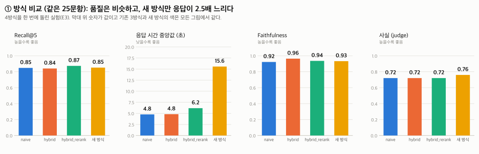
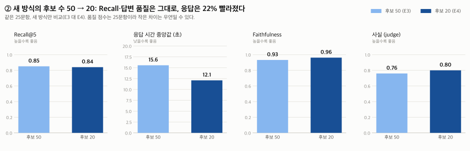
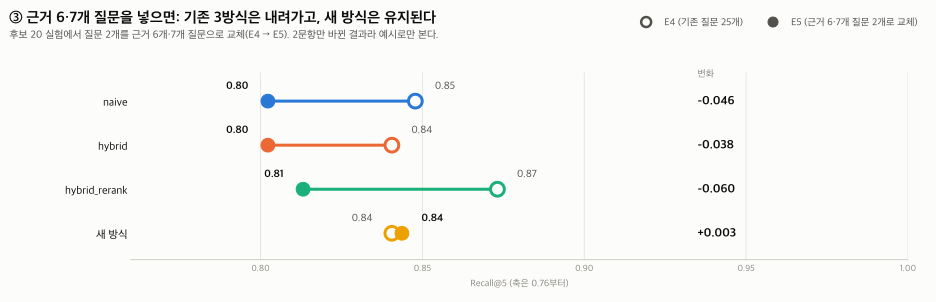
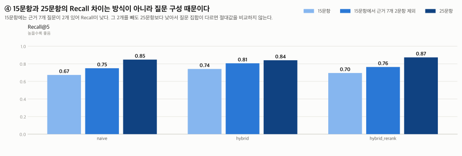

# EXP-0001. 검색 방식 4가지와 새 방식의 후보 수 비교 (사후 정리)

- 상태: 완료
- 날짜: 2026-11-11 (실행 11/9-11/11)
- 작성자: @ohjuhun1119
- run_id: `20261109-195104-assumed-frozen-bc0142a`(E1), `20261110-163436-extra25`(E2), `20261111-105753-four25`(E3), `20261111-153008-four25-c20`(E4), `20261111-154410-four25h-c20`(E5)
- 관련: Issue/PR #125, #126, #128, spec `docs/specs/metrics.md`

> **사후 정리다.** 결과를 보기 전에 가설과 성공 기준을 적지 않았고, 여러 실험을 돌려 본 뒤 한 문서로 모았다. 한 문서에 실험 5개(E1-E5)가 들어 있어 "바꾼 변수 하나" 원칙은 실험마다 아래 표에 적었다.
> 원자료(`results/runs/<run_id>/`)와 judge 채점 파일은 답안·문맥이 들어 있어 저장소에 올리지 않았다. 이 문서에는 집계 수치만 있다.

> 질문 15-25개로 돌린 **작은 실험**이라 한 질문이 평균에 4-7%를 준다. **작은 차이로 방식의 우열을 말하지 않는다.**

## 1. 한눈에 보기

1. **답변 품질은 방식 사이에 뚜렷한 차이가 없다.** (E3) Faithfulness 0.92-0.96, 사실 0.72-0.76(한 문항이 0.04).
2. **차이가 나는 것은 비용이다.** 새 방식의 응답 중앙값 15.6초(후보 50) / 12.1초(후보 20)로 hybrid_rerank 6.2초의 약 2-2.5배, 출력 토큰도 약 1.5배.
3. **새 방식의 후보 수를 50 → 20으로 줄여도** Recall은 같고(0.85 대 0.84) 답변 품질이 떨어진 신호가 없으며 응답은 중앙값 22% 줄었다.
4. **근거가 6-7개인 어려운 질문을 넣으면** 기존 3방식 Recall은 0.04-0.06 내려가고 새 방식은 유지돼(0.84) 1위가 hybrid_rerank에서 새 방식으로 바뀐다. 질문 2개를 바꾼 결과라 예시로만 쓴다.
5. **Recall 절대값은 질문 구성에 좌우된다.** 15문항(0.67-0.74)과 25문항(0.84-0.87)의 차이는 근거 7개 질문 2개가 15문항에만 있어서다. 같은 질문 집합 안에서만 비교한다.
6. **Hit@5는 변별력이 없다**(모든 실험·방식에서 1.00). 조건·근거·판단은 채점이 흔들려 **해석 보류**(우열의 근거로 쓰지 않음).

## 2. 실험 목록

| ID | 날짜 | 무엇을 했나 | 질문 | 채점 |
|---|---|---|---|---|
| E1 | 11/9 | 3방식 15문항 (1차) | 15개 (9/3/3) | 리허설 채점(정식 전) |
| E2 | 11/10 | 3방식 25문항 (2차) | 25개 (17/4/4) | 채점 완료 75건 |
| E3 | 11/11 | **4방식** 25문항, 새 방식 후보 50 | 25개 (17/4/4) | 채점 완료 100건 |
| E4 | 11/11 | 4방식 25문항, 새 방식 **후보 20** | E3과 같은 25개 | 새 방식 25건만 채점 |
| E5 | 11/11 | 4방식, **근거 6·7개 질문 2개로 교체**(후보 20) | 25개 (E4에서 2개 교체) | 채점 전 |

(질문 괄호는 답변/추가 확인/보류 개수. run_id·커밋·설정은 부록 B.)

## 3. 핵심 비교 (그림)

그림은 밝은/어두운 화면 설정에 맞춰 자동으로 바뀐다. 막대 위 숫자가 값이고, 네 방식의 색은 모든 그림에서 같다.

### 3-1. 방식 비교 (E3: 4방식, 같은 25문항)

<picture>
  <source media="(prefers-color-scheme: dark)" srcset="img/fig1_methods_dark.svg">
  
</picture>

품질(Faithfulness·사실)은 비슷하고 Recall도 0.84-0.87로 붙어 있다. **새 방식만 응답 중앙값이 15.6초로 hybrid_rerank(6.2초)의 약 2.5배다.**

### 3-2. 새 방식의 후보 수 50 → 20 (E3 대 E4, 같은 25문항)

<picture>
  <source media="(prefers-color-scheme: dark)" srcset="img/fig2_candidates_dark.svg">
  
</picture>

Recall은 같고 응답 중앙값은 15.6 → 12.1초(−22%)로 줄었다. Faithfulness의 문항별 변화(0.045)는 같은 방식을 다시 돌렸을 때의 변화(0.046)와 같아 **품질이 떨어졌다는 신호는 없다.** 다만 25문항이라 "같다"를 증명한 것은 아니다.

### 3-3. 근거 6·7개 질문을 넣으면 (E4 → E5, 질문 2개 교체)

<picture>
  <source media="(prefers-color-scheme: dark)" srcset="img/fig3_hard_questions_dark.svg">
  
</picture>

청크 5개로는 근거 7개 질문의 Recall이 최대 0.71이라 기존 3방식은 내려가고 새 방식은 유지됐다. 시드로 뽑은 2문항뿐이고 분해가 실행마다 달라지므로 예시로만 본다.

### 3-4. 질문 15개 대 25개 (E1 대 E2, 질문 집합이 다름)

<picture>
  <source media="(prefers-color-scheme: dark)" srcset="img/fig4_question_sets_dark.svg">
  
</picture>

15문항의 Recall이 낮은 가장 큰 이유는 근거 7개 질문 2개다. 그것을 빼도 25문항보다 낮고 방식 순위도 달라서 **두 질문 집합의 Recall 절대값은 비교하지 않는다.**

## 4. 읽는 법과 한계, 결정이 필요한 것

- **같은 질문 집합 안에서만 비교한다.** E3 대 E4는 후보 수 효과, E4 대 E5는 질문 구성 효과다.
- **노이즈:** 기존 3방식의 검색 지표는 실행마다 같지만(검색 결정적) 응답 이상치(20-50초)와 답변 상태 분포는 달라진다. 새 방식은 분해가 비결정적이라 Recall·MRR도 조금 흔들린다.
- **채점의 한계:** 조건은 AI가 해당 없음을 거의 채점하지 않아 사람 일치가 14/25로 낮다. 판단은 상태 불일치에도 1점을 주는 관대한 칸이다. 사람 대조는 25건·사례당 1명이다.
- **E1은 리허설 채점**이라 절대값이 낙관적일 수 있다. **E5는 아직 채점하지 않았다**(필요하면 새 방식 25건만).
- **정해야 할 것:** S-FINAL-29, S-DEV-27은 1·2차 사람 대조에서 모두 사람 1점·AI 0점으로 갈렸다(정답지의 필수 사실을 어떻게 읽느냐의 차이). 팀이 해석을 정해야 한다. S-FINAL-23, S-VAL-DEV-03은 사람 채점자가 정답 라벨에 의문을 남겨 경계 사례로 따로 본다.

## 부록 A. 실험별 결과 (실험마다 표 하나)

모든 실험에서 Hit@5는 전 방식 1.00이고 오류는 0건이다. Recall·MRR은 근거 문서가 있는 질문(15문항 실험 14개, 25문항 실험 23개) 기준이다. *는 해석 보류.

### E1. 3방식 15문항 (1차) (11/9, 리허설 채점(정식 전))

| 방식 | Recall | MRR | 응답 중앙값(초) | 응답 평균(초) | 입력 / 출력 토큰 | Faith. | 사실 | 조건 / 근거 / 판단* |
|---|---|---|---|---|---|---|---|---|
| naive | 0.67 | 0.73 | 6.8 | 7.7 | 39,013 / 5,584 | 0.86 | 0.67 | 0.80 / 0.93 / 0.93 |
| hybrid | 0.74 | 0.77 | 6.1 | 6.7 | 39,626 / 4,585 | 0.86 | 0.67 | 0.87 / 0.93 / 0.93 |
| hybrid_rerank | 0.70 | 0.89 | 7.4 | 7.6 | 40,600 / 4,543 | 0.96 | 0.73 | 1.00 / 1.00 / 0.80 |

### E2. 3방식 25문항 (2차) (11/10, 채점 완료 75건)

| 방식 | Recall | MRR | 응답 중앙값(초) | 응답 평균(초) | 입력 / 출력 토큰 | Faith. | 사실 | 조건 / 근거 / 판단* |
|---|---|---|---|---|---|---|---|---|
| naive | 0.85 | 0.88 | 5.7 | 7.1 | 64,377 / 9,017 | 0.94 | 0.64 | 0.96 / 1.00 / 0.92 |
| hybrid | 0.84 | 0.83 | 6.0 | 6.5 | 64,650 / 8,605 | 0.96 | 0.72 | 0.96 / 0.96 / 0.92 |
| hybrid_rerank | 0.87 | 0.93 | 7.6 | 8.4 | 66,523 / 8,250 | 0.96 | 0.68 | 0.96 / 0.92 / 0.96 |

### E3. 4방식 25문항, 새 방식 후보 50 (11/11, 채점 완료 100건)

| 방식 | Recall | MRR | 응답 중앙값(초) | 응답 평균(초) | 입력 / 출력 토큰 | Faith. | 사실 | 조건 / 근거 / 판단* |
|---|---|---|---|---|---|---|---|---|
| naive | 0.85 | 0.88 | 4.8 | 5.7 | 64,377 / 9,691 | 0.92 | 0.72 | 0.92 / 1.00 / 0.96 |
| hybrid | 0.84 | 0.83 | 4.8 | 4.8 | 64,650 / 8,203 | 0.96 | 0.72 | 1.00 / 1.00 / 0.88 |
| hybrid_rerank | 0.87 | 0.93 | 6.2 | 6.7 | 66,523 / 8,684 | 0.94 | 0.72 | 0.96 / 1.00 / 0.92 |
| 새 방식 | 0.85 | 0.93 | 15.6 | 16.7 | 71,026 / 13,824 | 0.93 | 0.76 | 0.96 / 0.96 / 0.92 |

### E4. 4방식 25문항, 새 방식 후보 20 (11/11, 새 방식 25건만 채점)

| 방식 | Recall | MRR | 응답 중앙값(초) | 응답 평균(초) | 입력 / 출력 토큰 | Faith. | 사실 | 조건 / 근거 / 판단* |
|---|---|---|---|---|---|---|---|---|
| naive | 0.85 | 0.88 | 5.1 | 6.0 | 64,377 / 8,436 | 미채점 | 미채점 | 미채점 |
| hybrid | 0.84 | 0.83 | 4.5 | 5.7 | 64,650 / 8,631 | 미채점 | 미채점 | 미채점 |
| hybrid_rerank | 0.87 | 0.93 | 6.5 | 7.8 | 66,523 / 9,281 | 미채점 | 미채점 | 미채점 |
| 새 방식 | 0.84 | 0.91 | 12.1 | 14.0 | 70,718 / 12,913 | 0.96 | 0.80 | 0.96 / 1.00 / 0.92 |

### E5. 4방식, 근거 6·7개 질문 2개로 교체(후보 20) (11/11, 채점 전)

| 방식 | Recall | MRR | 응답 중앙값(초) | 응답 평균(초) | 입력 / 출력 토큰 | Faith. | 사실 | 조건 / 근거 / 판단* |
|---|---|---|---|---|---|---|---|---|
| naive | 0.80 | 0.88 | 5.2 | 6.8 | 64,457 / 7,290 | 미채점 | 미채점 | 미채점 |
| hybrid | 0.80 | 0.83 | 4.3 | 5.4 | 64,470 / 6,476 | 미채점 | 미채점 | 미채점 |
| hybrid_rerank | 0.81 | 0.91 | 6.2 | 7.4 | 66,801 / 8,464 | 미채점 | 미채점 | 미채점 |
| 새 방식 | 0.84 | 0.91 | 11.2 | 13.8 | 70,834 / 11,761 | 미채점 | 미채점 | 미채점 |

- MRR은 정답 문서가 처음 나온 순위의 역수 평균(참고용, 새 방식은 번갈아 채워서 의미가 다름). 응답 시간은 정상 요청 기준이다. E4는 새 방식 25건만 채점했다(기존 3방식은 E3과 검색이 같고 노이즈 기준선은 E2 대 E3로 대신함).

## 부록 B. 실행 기록

| ID | run_id | 실행 커밋 | 새 방식 후보 수 | 실행 시각 |
|---|---|---|---|---|
| E1 | `20261109-195104-assumed-frozen-bc0142a` | 기록 없음(bc0142a) | - | 11-09 19:51 - 19:56 |
| E2 | `20261110-163436-extra25` | efba38c | - | 11-10 16:34 - 16:43 |
| E3 | `20261111-105753-four25` | 9069f69 | 50 | 11-11 10:57 - 11:12 |
| E4 | `20261111-153008-four25-c20` | 6d22cb7 | 20 | 11-11 15:30 - 15:44 |
| E5 | `20261111-154410-four25h-c20` | 6d22cb7 | 20 | 11-11 15:44 - 15:58 |

- 11/9 사전 실행 2회(`prefreeze`, `prefreeze2`)는 15문항 3방식을 동결 전 설정으로 돌렸고 Qdrant 시간 초과로 각각 1/45건 오류가 났다(#106). 제한 시간·재시도(#110) 뒤 오류 0/45가 된 것이 E1이다.
- E3의 후보 50은 실행 당시 `config.py` 값이고 `run_meta`의 `config_overrides`로 기록했다. E4·E5의 후보 20은 #128로 `main` 값이 20이 된 뒤 실행했다.
- 새 방식만 먼저 돌렸던 초기 실행(`cand20-q25`, `cand20-q25h`)은 같은 질문을 4방식으로 다시 돌린 E4·E5로 대체했다.
